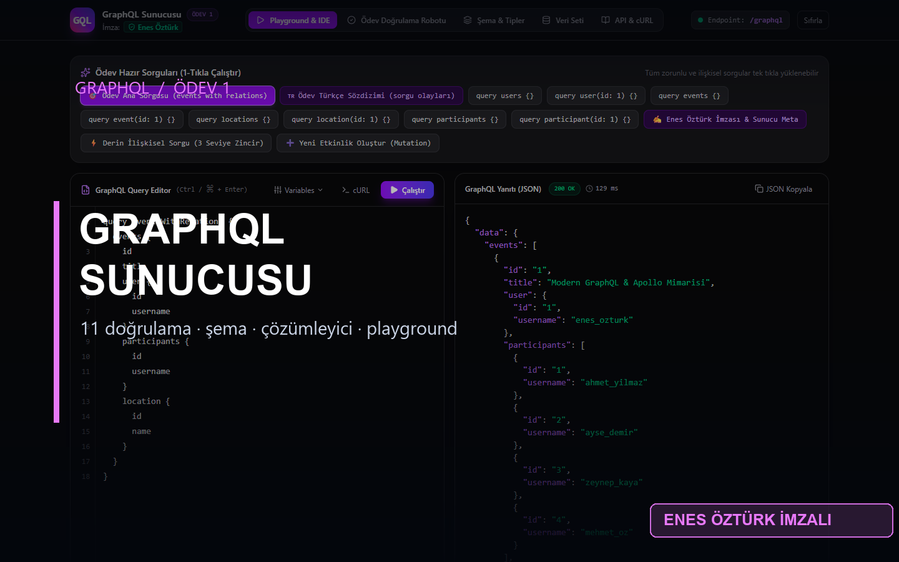
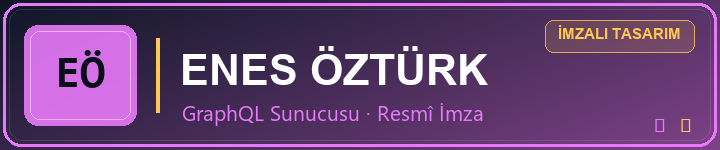
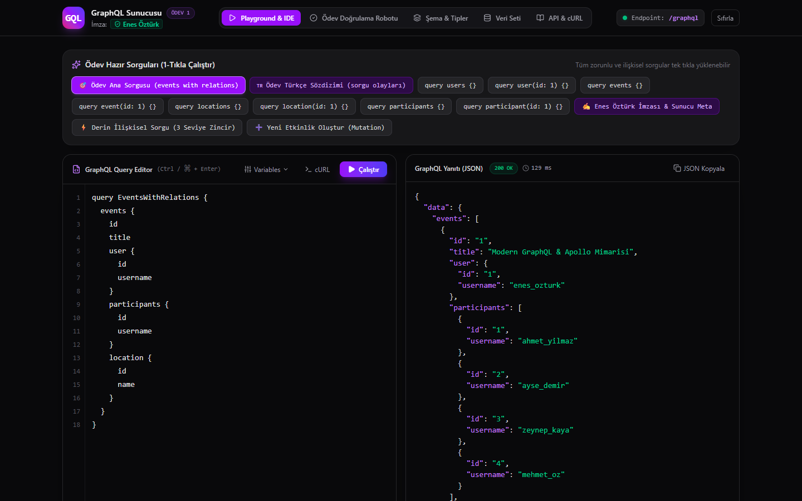
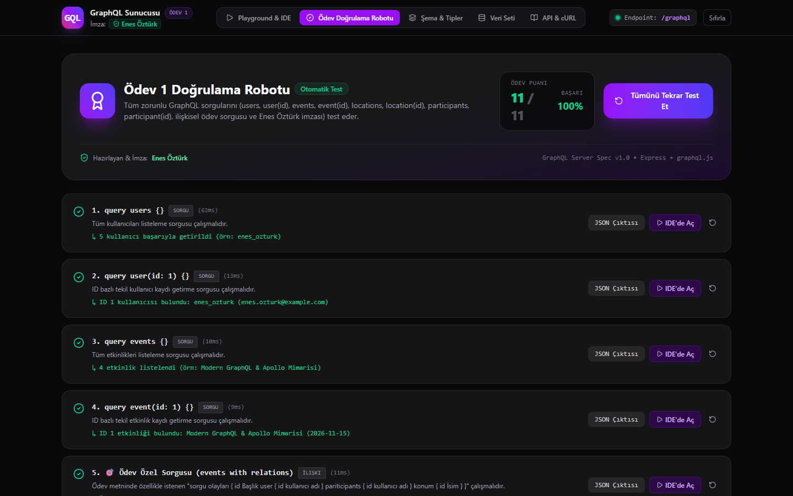
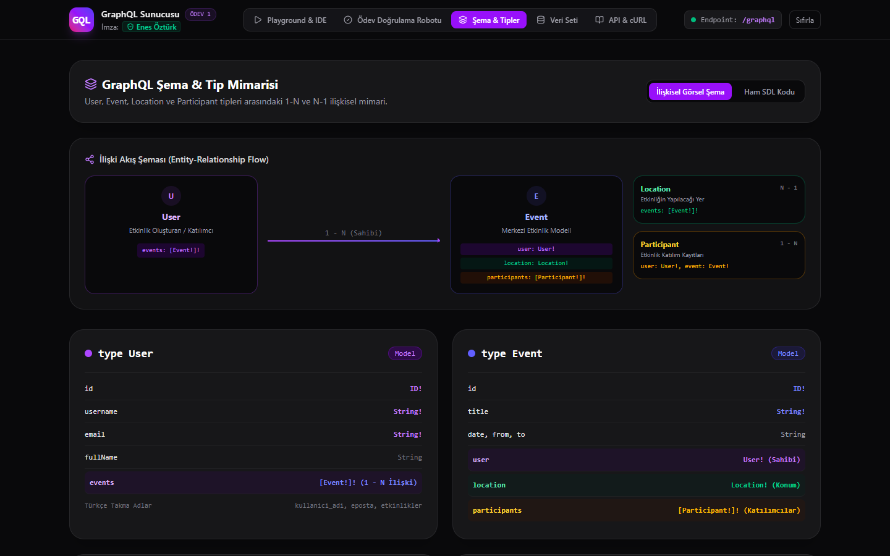

<div align="center">



# GraphQL Sunucusu

**Ödev 1 — şema, çözümleyiciler, 11 doğrulama adımı ve etkileşimli playground içeren GraphQL backend çalışması.**

[](https://github.com/EnesBinMalik/graphql-sunucusu)
[](https://github.com/EnesBinMalik/graphql-sunucusu)
[](https://github.com/EnesBinMalik/graphql-sunucusu)
[](https://github.com/EnesBinMalik/graphql-sunucusu)
[](https://github.com/EnesBinMalik/graphql-sunucusu)
[](https://github.com/EnesBinMalik)



</div>

---

## Hakkında

GraphQL Sunucusu, Patika.dev'in ilk GraphQL ödevidir. Kullanıcılar, etkinlikler, konumlar ve katılımcılar arasındaki ilişkileri sorgulayan bir şema kurulur; doğrulama robotu 11 ayrı kriteri adım adım kontrol eder. Playground gerçek sorguları çalıştırır, sonuçları ve cURL çıktısını gösterir.

> Bu proje **Enes Öztürk** tarafından tasarlanmış, geliştirilmiş ve imzalanmıştır.

---

## Öne çıkan özellikler

| Özellik | Açıklama |
| --- | --- |
| **11 doğrulama** | Ödev gereksinimlerini tek tek denetleyen robot. |
| **Playground & IDE** | Sorgu yazma, çalıştırma ve sonuç görüntüleme. |
| **Ödev ana sorgusu** | İlişkisel `events` sorgusu için hazır şablon. |
| **Türkçe sözdizimi** | Türkçe alan adlarıyla alternatif sorgu. |
| **Derin ilişki** | 3 seviyeli çözümleyici zinciri. |
| **Mutation** | Yeni etkinlik oluşturma sorgusu. |

---

## Doğrulama

| Ölçü | Değer |
| --- | --- |
| Kriter | 11 |
| Tip | 5 |
| Sorgu | 9 hazır |
| Uç | /graphql |

---

## Galeri







---

## Kurulum

**Gereksinim:** Node.js 20+

```bash
git clone https://github.com/EnesBinMalik/graphql-sunucusu.git
cd graphql-sunucusu
npm install
npm run start
```

> Doğrulama robotu hem şemayı hem dönüş verisini kontrol eder.

Diğer komutlar:

```bash
npm run build     # Üretim derlemesi
npm run preview   # Derlemeyi önizle
npm run lint      # TypeScript tip kontrolü
```

---

## Teknik mimari

```text
src/graphql/schema.ts      Şema tanımı
src/graphql/presets.ts     Hazır sorgular
src/graphql/data.json      Veri kümesi
src/components/Playground.tsx  Sorgu editörü
src/components/HomeworkVerifier.tsx  Doğrulama robotu
server.ts                  Express sunucusu
```

---

## İmza

<div align="center">

[](https://github.com/EnesBinMalik)
[](https://github.com/EnesBinMalik)

**Bu kod, tasarım ve deneyim Enes Öztürk'ün kişisel imzasını taşır.**

© 2026 Enes Öztürk — Tüm hakları saklıdır.

</div>
